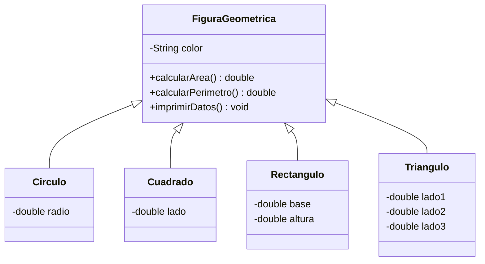

# 📐 Figuras geométricas en Java — Semana 6

> **Programación Orientada a Objetos (POO) · ESFOT**  
> Ejercicio práctico de herencia, sobrescritura de métodos y polimorfismo.

## 🎯 Descripción

Proyecto académico que modela figuras geométricas mediante una clase base `FiguraGeometrica` y clases especializadas: `Circulo`, `Cuadrado`, `Rectangulo` y `Triangulo`. Cada figura calcula su **área** y **perímetro** según sus dimensiones.

La actividad permite comprender cómo reutilizar atributos y métodos de una superclase, redefinir comportamientos con `@Override` y trabajar con objetos de diferentes clases mediante referencias del tipo padre.

## 🧠 Conceptos de POO

| Concepto | Aplicación |
|---|---|
| Herencia simple | Las figuras especializadas extienden `FiguraGeometrica`. |
| Encapsulamiento | Atributos privados y métodos de acceso. |
| Constructores y `super` | Inicialización de atributos propios y heredados. |
| Sobrescritura | `calcularArea()`, `calcularPerimetro()` e `imprimirDatos()`. |
| Polimorfismo | Una referencia `FiguraGeometrica` puede apuntar a distintas figuras. |
| Validación | Comprobación de dimensiones positivas y desigualdad triangular. |
| Entrada por teclado | Selección de figura y captura de dimensiones con `Scanner`. |

## 🗂️ Organización del código

Estructura orientativa de las clases desarrolladas en el ejercicio:

```text
src/
├── geometria/
│   ├── FiguraGeometrica.java
│   ├── Circulo.java
│   ├── Cuadrado.java
│   ├── Rectangulo.java
│   └── Triangulo.java
└── Main.java
```

> La ubicación exacta de `Main.java` y los métodos disponibles deben comprobarse en la versión del repositorio que se esté utilizando.

## 🧬 Jerarquía de clases



## 📏 Figuras y fórmulas

| Figura | Datos requeridos | Área | Perímetro |
|---|---|---|---|
| Círculo | Radio `r` | `π × r²` | `2 × π × r` |
| Cuadrado | Lado `l` | `l²` | `4 × l` |
| Rectángulo | Base `b`, altura `h` | `b × h` | `2 × (b + h)` |
| Triángulo | Lados `a`, `b`, `c` | Fórmula de Herón | `a + b + c` |

Para el triángulo, el semiperímetro es `s = (a + b + c) / 2`, y el área es `√(s(s-a)(s-b)(s-c))`. Los lados deben ser positivos y cumplir la desigualdad triangular.

## 🔁 ¿Dónde está el polimorfismo?

```java
FiguraGeometrica figura = new Circulo("Rojo", 5);
figura.imprimirDatos();

figura = new Rectangulo("Azul", 4, 6);
figura.imprimirDatos();
```

La referencia tiene tipo `FiguraGeometrica`, pero el método sobrescrito que se ejecuta corresponde a la clase real del objeto.

En las clases hijas, `super.imprimirDatos()` permite reutilizar la impresión común del padre y agregar datos propios, como radio, lado, base, altura o los tres lados.

## ▶️ Ejecución

**Requisitos:** JDK instalado y un IDE como IntelliJ IDEA, Eclipse o VS Code, o una terminal.

1. Clona el repositorio:

   ```bash
   git clone https://github.com/jzaldumbide/seman6_figuras.git
   cd seman6_figuras
   ```

2. Abre la carpeta como proyecto Java en tu IDE.
3. Localiza la clase que contiene `public static void main(String[] args)` y ejecútala.
4. Si la versión incluye el menú interactivo, selecciona una figura, ingresa sus dimensiones y observa el área y el perímetro.

### Ejemplo de salida esperada

```text
===== FIGURAS GEOMÉTRICAS =====
1. Círculo
2. Cuadrado
3. Rectángulo
4. Triángulo
5. Salir

Seleccione una opción: 4
Ingrese el color: Azul
Ingrese lado 1: 3
Ingrese lado 2: 4
Ingrese lado 3: 5

=== TRIÁNGULO ===
Lado 1: 3.0
Lado 2: 4.0
Lado 3: 5.0
Color: Azul
Área: 6.00
Perímetro: 12.00
```

*La salida es ilustrativa del menú propuesto para el ejercicio; puede diferir de la implementación publicada.*

## 🧪 Actividades para estudiantes

1. **Sobrescritura:** implementa `imprimirDatos()` en cada figura para mostrar sus dimensiones particulares y reutilizar `super.imprimirDatos()`.
2. **Validaciones:** impide radios, lados, bases y alturas no positivos; comprueba que los tres lados formen un triángulo válido.
3. **Menú:** usa `Scanner` y `switch` para elegir la figura y solicitar datos por teclado.
4. **Polimorfismo:** almacena distintas figuras en una `List<FiguraGeometrica>` y recórrela para mostrar resultados.
5. **Ampliación:** incorpora una clase `Trapecio` y agrega una opción al menú.

## ❓ Preguntas de repaso

- ¿Qué diferencia existe entre heredar un método y sobrescribirlo?
- ¿Para qué sirve `super()` dentro de un constructor?
- ¿Por qué `FiguraGeometrica figura = new Circulo("Rojo", 5);` es válido?
- ¿Qué versión de `imprimirDatos()` se ejecuta y por qué?
- ¿Qué ventaja ofrece definir `calcularArea()` en la clase padre?

## 📚 Propósito académico

Este repositorio sirve como material de apoyo para la asignatura **Programación Orientada a Objetos** y como base para ejercicios posteriores sobre colecciones, clases abstractas, interfaces y polimorfismo.

---

**Nota de alcance:** Esta documentación se elaboró a partir de las clases y el ejercicio compartidos durante la sesión. No se ha comprobado el contenido individual de los archivos publicados en GitHub, por lo que algunos nombres, rutas o funcionalidades pueden requerir ajustes antes de subir este README.
